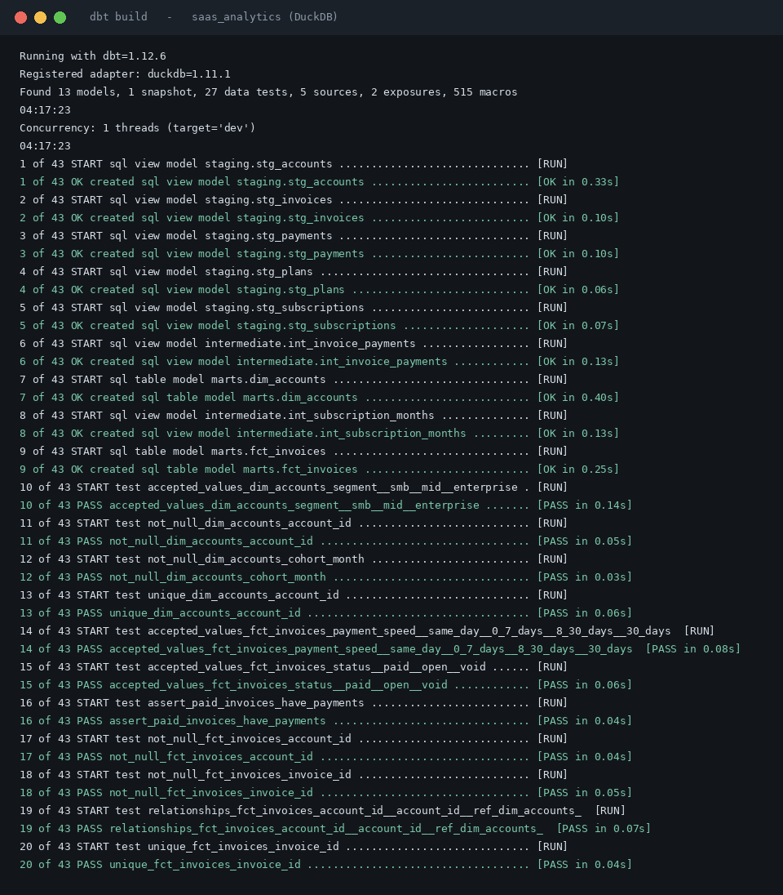
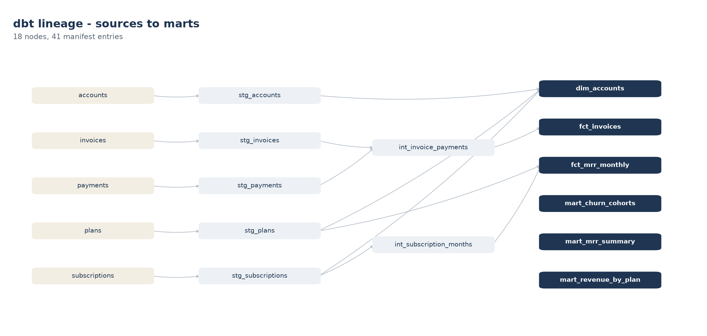
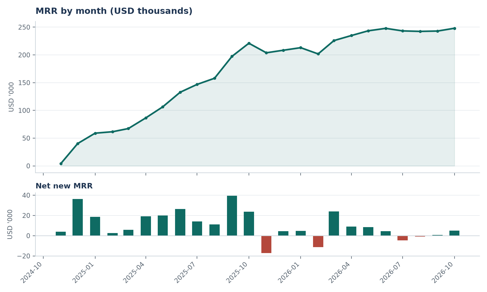
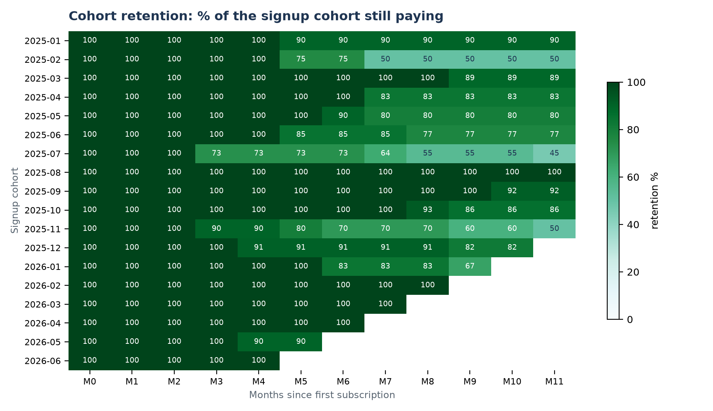
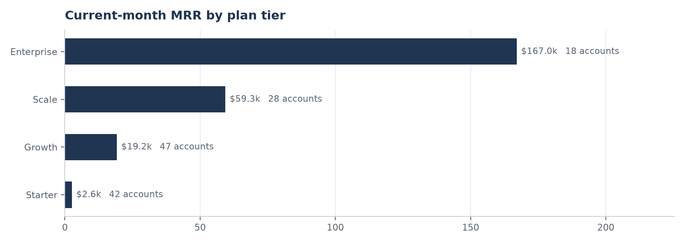

# SaaS Revenue Analytics with dbt


A dbt project that turns raw SaaS billing exports into the four numbers a
subscription business runs on: **MRR, net new MRR, ARR and cohort retention**.
Staging, intermediate and mart layers, an incremental fact table, a type-2
snapshot, 27 data tests and two documented exposures.

`dbt build` runs end to end on DuckDB with no warehouse account and no
credentials, so you can clone it and see every model, test and chart in about
thirty seconds.



| Signal | Value |
|---|---|
| Models | 13 (5 staging, 2 intermediate, 6 marts) |
| Data tests | 27 - generic plus 5 singular SQL assertions |
| Build result | 43 nodes, 0 failures |
| Data volume | 180 accounts, 207 subscriptions, 2,298 invoices over 24 months |
| Latest MRR | $248,047 (ARR $2.98M) |
| Runtime | ~12 seconds cold, ~4 seconds on a re-run |

---

## The problem this solves

The billing system exports five CSVs every month, and each one is messy in its
own way: dates in two formats, amounts as text with thousand separators,
duplicate invoices from a re-run billing job, voided invoices stored as negative
amounts, and subscription records that end on the same day the next one starts
because of mid-cycle upgrades.

Finance rebuilds MRR in a spreadsheet each month and the number moves for
reasons nobody can explain. This project replaces that with a versioned,
tested definition: one model owns MRR, one model owns retention, and if the
data breaks a test the build fails instead of publishing a wrong number.

## Lineage



```
sources (CSV)  ->  staging  ->  intermediate  ->  marts
5 raw exports     5 models      2 models          6 marts
```

The two intermediate models carry the hard thinking:

- **`int_subscription_months`** expands every subscription into one row per
  calendar month it was active. That is the spine: MRR is a sum over months, not
  a sum over subscriptions, and getting this grain right is what makes expansion,
  churn and retention consistent with each other.
- **`int_invoice_payments`** joins invoices to payments and computes days-to-pay,
  so "is revenue actually being collected" is a column, not a separate report.

## What the marts show



MRR grew from $4k to $248k over 24 months, but the net-new bars show two
negative months (November 2025 and February 2026) where churn outran new
business - the kind of month a spreadsheet averages away.



Cohort retention is computed from the same fact table, so it reconciles with
MRR by construction. The 2025-07 cohort is the weak one: it falls to 45% by
month 11, against 83-90% for most other cohorts.



## Quickstart

```bash
git clone https://github.com/Yashu24-coder/dbt-saas-analytics.git
cd dbt-saas-analytics
pip install -r requirements.txt
python scripts/generate_seeds.py     # writes data/raw/*.csv
dbt build --profiles-dir .
```

That is the whole setup - `profiles.yml` is committed on purpose, because a
DuckDB target needs no credentials. To browse the docs site:

```bash
dbt docs generate --profiles-dir . && dbt docs serve --profiles-dir .
```

Or use the Makefile:

```bash
make build      # dbt build
make test       # tests only
make docs       # generate and serve the docs site
make lineage    # redraw the lineage and charts in docs/images
```

## Model reference

| Layer | Model | Materialisation | What it does |
|---|---|---|---|
| staging | `stg_plans` | view | Types the plan price, title-cases the name |
| staging | `stg_accounts` | view | Parses two date formats, normalises country labels |
| staging | `stg_subscriptions` | view | Parses start/end dates, fills open-ended periods |
| staging | `stg_invoices` | view | Collapses duplicates, strips thousand separators, flags credit notes |
| staging | `stg_payments` | view | Types payment amounts and dates |
| intermediate | `int_subscription_months` | view | Month spine: one row per subscription per active month |
| intermediate | `int_invoice_payments` | view | Invoice-to-payment join with days-to-pay |
| marts | `dim_accounts` | table | Account dimension with current plan and MRR |
| marts | `fct_mrr_monthly` | **incremental** | MRR at subscription-month grain |
| marts | `fct_invoices` | table | Invoice fact with payment speed banding |
| marts | `mart_mrr_summary` | table | MRR, net new MRR, ARR, ARPU by month |
| marts | `mart_churn_cohorts` | table | Retention by signup cohort and month number |
| marts | `mart_revenue_by_plan` | table | Current MRR by plan tier with share of total |

Full column-level detail: [docs/model_reference.md](docs/model_reference.md).

## Testing

27 data tests run on every build. Four of them are the ones that matter:

| Test | The bug it catches |
|---|---|
| `assert_one_active_subscription_per_account_month` | An account billed twice in one month because an upgrade overlapped the old subscription |
| `assert_paid_invoices_have_payments` | An invoice marked paid with no matching payment, which inflates collected revenue |
| `assert_mrr_never_negative` | A broken seats join or price cast producing negative MRR |
| `assert_no_future_months` | The month spine running past the analysis end date and inventing revenue |

The generic tests (`unique`, `not_null`, `relationships`, `accepted_values`) cover
keys and referential integrity across all six marts. `assert_retention_within_bounds`
is a cheap sanity check that a percentage stays a percentage.

## Design decisions worth knowing

- **MRR lives in one model.** `fct_mrr_monthly` is the only place plan price
  multiplies seats. Every mart reads it, so MRR, ARR, ARPU and retention cannot
  drift apart.
- **Upgrades take effect on a month boundary.** The generator models a plan
  change as ending one subscription on the last day of the month and starting the
  next on the first. Mid-month overlap would double bill that month; the singular
  test above enforces the rule.
- **Credit notes stay in the invoice fact, flagged.** Voided invoices are stored
  as negative amounts upstream. Rather than filter them at staging - which hides
  the fact that they exist - `is_credit_note` carries the flag and the marts
  exclude them from revenue explicitly.
- **`fct_mrr_monthly` is incremental on a hash key.** `mrr_row_id` is
  `md5(subscription_id | month_start)`, so re-running a month replaces it rather
  than appending a second copy. Backfills are safe.
- **Sources are read in place.** dbt-duckdb reads the raw CSVs through
  `external_location`, so there is no load step and no seed table to keep in sync.
- **The snapshot captures plan changes.** `snap_accounts` is a check-strategy
  SCD2 on plan, segment and seats; run the build again after a plan change and it
  keeps the previous version instead of overwriting it.

## What this project does not do

- The source data is **synthetic**, generated by `scripts/generate_seeds.py`
  with the defects described above. The models and tests are real; the invoices
  are not.
- **No orchestrator in the repo.** In production this runs as an Airflow or dbt
  Cloud job on a schedule; the CI workflow here runs `dbt build` on every push,
  which is the part worth showing.
- **DuckDB, not Snowflake or BigQuery.** The SQL is deliberately portable - no
  warehouse-specific functions except `try_strptime` and `generate_series`, both
  of which have direct equivalents - but it has only been executed on DuckDB.
- **No semantic layer.** Metrics are defined in marts, not in a MetricFlow or
  LookML layer. That would be the next step if a BI tool needed governed metrics.

## Author

Built by **Kavali Yashwanth Royal** - data engineer, Bangalore.
[GitHub](https://github.com/Yashu24-coder) ·
[LinkedIn](https://www.linkedin.com/in/yashwanth-royal-kavali-226378259) ·
yashwanthroyal9133@gmail.com

If you are reviewing this, start with `models/intermediate/int_subscription_months.sql`
and `models/marts/core/fct_mrr_monthly.sql` - the grain decisions live there.
